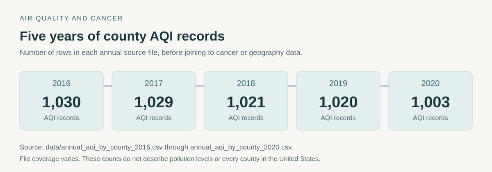

# Air Quality and Cancer

This project explores county-level air quality and cancer incidence in the United States using public data from 2016–2020. It brings the two datasets together in a Jupyter notebook, using maps, distributions, and simple comparisons to look for regional patterns.



*Annual AQI reporting records included in the analysis. [Counts as CSV](docs/aqi-data-coverage.csv).*

## Motivation

Air quality and cancer incidence both vary across the country. Comparing these public datasets brings together geographic data, health statistics, and environmental measurements. Matching locations and time periods provides a starting point for exploring their relationship.

The goal was to work through that comparison: clean the data, make the geography visible, and examine what a simple relationship between the two datasets might look like. The notebook follows the process from raw county records to visualizations and a simple regression.

## Questions

- How do cancer incidence rates and reported trends vary by county and region?
- How do AQI summaries and pollutant-specific day counts vary across the same period?
- What happens when the two datasets are compared at the county level?
- Does a simple linear model describe much of the variation in cancer incidence?

## Data

| Dataset | Included files | What it provides |
| --- | --- | --- |
| Annual county AQI summaries | [2016](data/annual_aqi_by_county_2016.csv), [2017](data/annual_aqi_by_county_2017.csv), [2018](data/annual_aqi_by_county_2018.csv), [2019](data/annual_aqi_by_county_2019.csv), [2020](data/annual_aqi_by_county_2020.csv) | Median and maximum AQI, observation days, AQI-category days, and pollutant-specific day counts |
| Cancer incidence report | [2016–2020 report](data/cancer_incd_rate_2016_2020.csv) | Age-adjusted incidence per 100,000 people, average annual case counts, confidence intervals, and reported trends |
| County lookup | [County table](data/uscounties/uscounties.csv) | FIPS codes, coordinates, state names, and population |

The AQI summaries follow the EPA [AirData](https://www.epa.gov/outdoor-air-quality-data) format. The cancer file is a [State Cancer Profiles](https://statecancerprofiles.cancer.gov/) export covering all cancer sites and stages, all races, both sexes, and all ages. Its footer contains the source and suppression notes, including SEER and National Program of Cancer Registries attribution.

The repository also contains daily lead-monitoring files for 2016–2020. The main notebook uses the annual AQI summaries rather than those daily files.

## Exploring the notebook

Open [aqi_cancer_eda.ipynb](aqi_cancer_eda.ipynb) to read the analysis and its saved output. It has four main parts:

1. **Data preparation:** convert numeric fields, handle suppressed or unavailable values, and attach county geography.
2. **Cancer exploration:** compare incidence rates and trends, inspect their distributions, and map regional variation.
3. **AQI exploration:** combine annual summaries and visualize air-quality measures geographically.
4. **Comparison:** join the datasets, inspect scatter plots and correlations, and fit a linear regression using median AQI to explain cancer incidence.

The implementation uses pandas and NumPy for data preparation, Plotly for interactive figures, and scikit-learn for the regression. Hover details in the Plotly figures make it possible to inspect individual counties alongside the broader pattern.

## Results

The notebook fits a linear regression with median AQI as the input and cancer incidence as the target. Its in-sample R² is approximately **0.00027**. Maps and scatter plots explore the regional variation behind those records.

## Further exploration

- Match county records by FIPS to distinguish places with the same name.
- Define trends at a consistent county or county-year level.
- Incorporate monitoring coverage, population, and exposure timing into the comparison.

## Working locally

Use Python 3.11 and run JupyterLab from the repository root so the relative `data/` paths resolve.

```sh
git clone https://github.com/TheDeafOne/aqi-and-cancer.git
cd aqi-and-cancer
python3.11 -m venv .venv
```

Activate with `source .venv/bin/activate` on macOS/Linux, or `.venv\Scripts\Activate.ps1` in Windows PowerShell. Then install the notebook tools and imported packages:

```sh
python -m pip install "numpy<2" "pandas==1.5.3" plotly scikit-learn jupyterlab nbformat
python -m jupyter lab
```

Open `aqi_cancer_eda.ipynb`. The environment uses pandas 1.5.3 for its grouping and correlation behavior. The data files and saved notebook output are included in the repository.
